


 


## 🚀 Selected Work

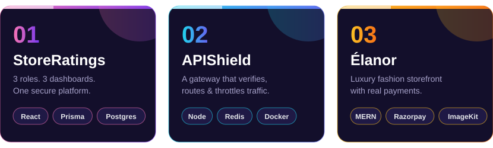

### 01 · StoreRatings

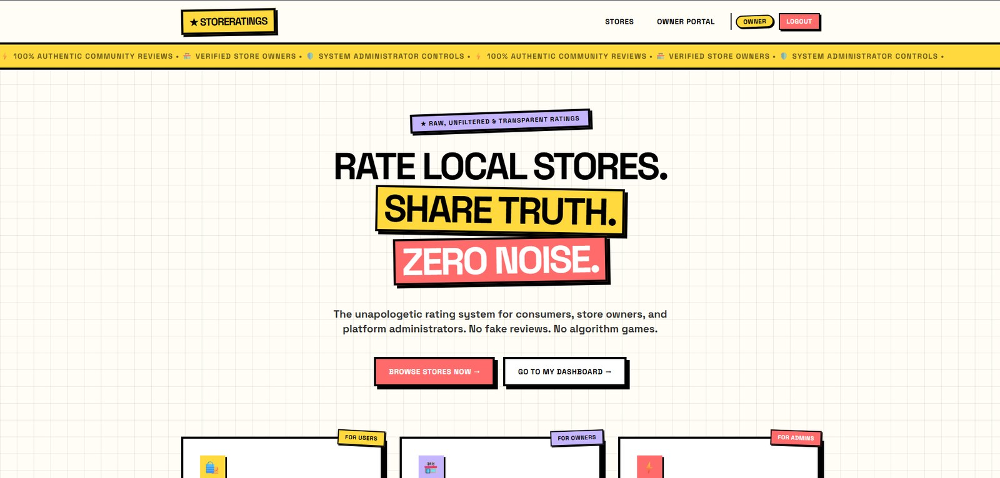

**One platform, three roles, scoped permissions.** Shoppers, store owners and admins each get their own dashboard, and each can only do what their role allows.

  

<b>🔍 How it works</b>

 

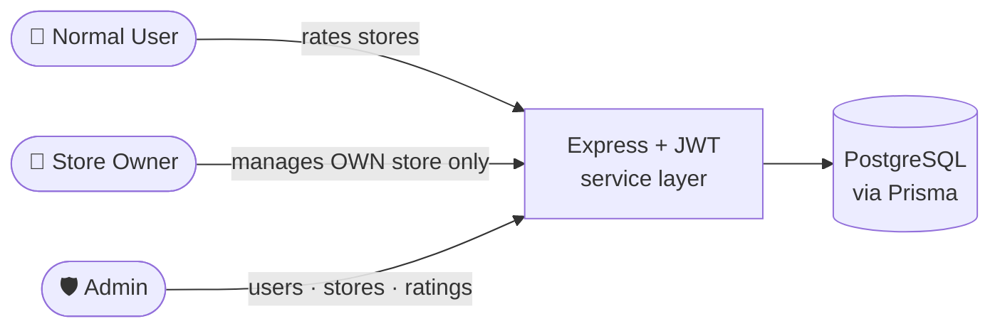

- 🔐 JWT auth, protected routes and ownership-based authorization
- ⭐ Duplicate-rating prevention
- 🧱 Service-layer backend: auth · store · rating · user
- 🛠️ Admin console for platform-wide management
- ☁️ Deployed end to end on Vercel, Render and Neon

`React` `Vite` `Node.js` `Express` `PostgreSQL` `Prisma` `JWT`

 

### 02 · APIShield

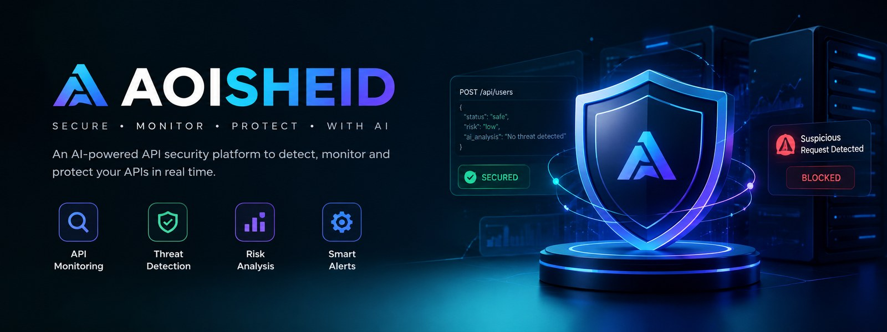

**A gateway that verifies, routes and throttles every request.** A production-style API gateway and security layer in front of microservices, with a live dashboard for traffic, logs and health.

<b>🔍 How it works</b>

 

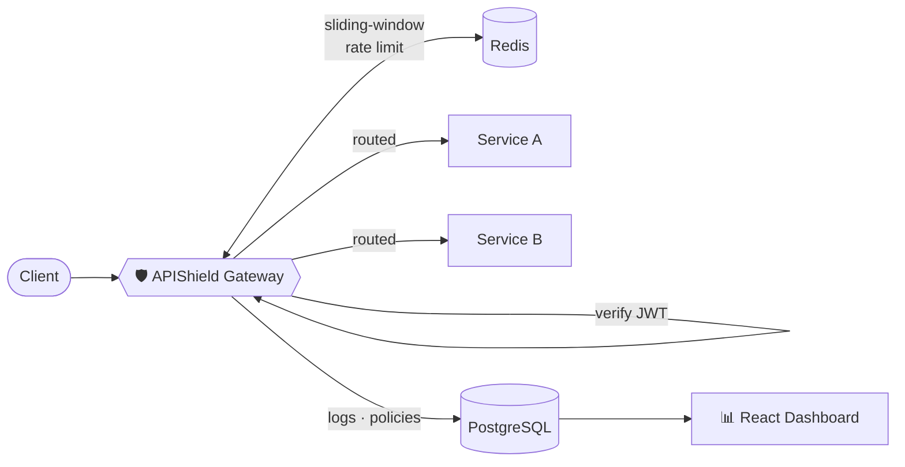

- 🚦 Redis sliding-window rate limiting per client / API key
- 🔑 Centralized JWT auth and request routing
- 📈 Live traffic, request logs and health metrics in a React dashboard
- 🐳 One-command Docker Compose deployment
- 🎨 Designed first, with its own `DESIGN.md` and indigo Figma system

`Node.js` `Express` `Redis` `PostgreSQL` `Prisma` `React` `TanStack Query` `Tailwind` `Docker`

 

### 03 · Élanor

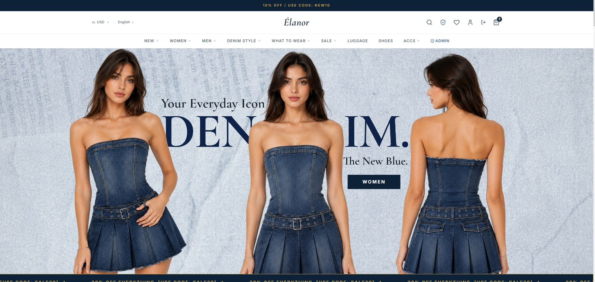

**Luxury fashion e-commerce with real payments.** A MERN storefront that feels premium, with an admin side that makes running the shop easy.

  

<b>🔍 What's inside</b>

 

- 🛍️ Search, filtering, cart and wishlist
- 💳 Razorpay payments and order processing
- 🖼️ ImageKit image delivery and optimization
- 🧑‍💼 Admin dashboard for products, categories, orders and users
- 🔐 JWT auth with role-based access for customers and admins

`MongoDB` `Express` `React` `Node.js` `JWT` `Razorpay` `ImageKit`

## 🧰 Toolbox

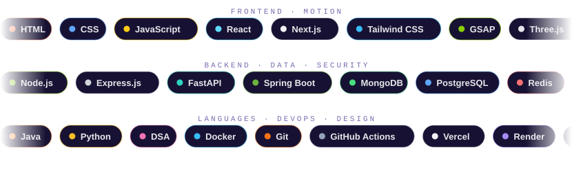

## 🧭 How I Work

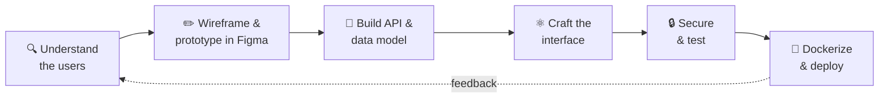

| 🎨 Design-led | 🔐 Security-minded | 🚢 Ship-ready |
|:--:|:--:|:--:|
| Flows and a design system come before code | Auth, ownership checks and rate limiting from day one | Real deployments and containers, not just localhost |

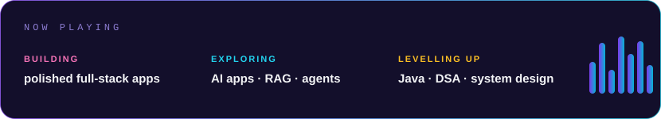

 

## 💬 Let's Talk

**Hiring for Full Stack or Java Backend? Or have an idea worth building?**

  

